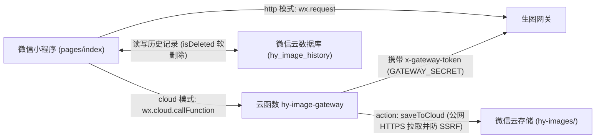

# Hy-Image 3.5 AI 工作台（微信小程序）

基于 **微信小程序 + 微信云开发（CloudBase）** 构建的混元生图（`hy-image-v3.5-preview`）AI 创作工作台。支持文生图、本地/外链垫图参考生图、画幅与 1K~4K 分辨率调节、纯净无水印模式、联网搜索增强、多轮连续修图，以及自动云存储持久化与跨设备云端历史同步。

---

## 核心功能

- **双生图模式**
  - **文生图（`text2image`）**：支持最长 2000 字画面描述、内置随机灵感提示词与 6 类快捷风格标签一键追加。
  - **垫图 / 参考生图（`image2image`）**：支持从相册/相机选图（云函数通道自动上传云存储生成临时链接，HTTP 通道自动压缩转 Base64 Data URL），也支持直接输入公网 `http/https` 图片链接，并可将已生成画作一键「设为垫图」继续二次创作。
- **画幅比例与清晰度档位**
  - 支持 `auto`（模型智能匹配）、`1:1`、`4:3`、`3:4`、`16:9`、`9:16` 及 `custom`（自由宽高，单边 `256 ~ 8192` px，总像素不超过 `4096×4096`）。
  - 支持 `自动`、`1K`、`1.5K`、`2K`、`4K` 清晰度档位（`auto` 比例下支持 `1K` / `1.5K` / `2K` 像素上限预设）。
- **高级参数控制**
  - **纯净无水印模式**：默认开启（通过 `footnote: " "` 消除右下角默认水印），关闭后可配置最多 16 字符的自定义水印。
  - **联网搜索增强（`use_search_tool`）**：结合实时网络信息增强画面时效与细节。
  - **随机种子（`seed`）** 与 **会话标识（`session`）**：支持指定或随机生成种子、随时新建会话。
- **多轮连续修图**
  - 自动维护上游返回的 `assembled_history` 上下文，出图后可直接输入修改要求（如“把背景换成黄昏雪山”）进行多轮连续迭代。
- **云存储自动转存与云数据库历史管理**
  - 出图成功后自动写入本地缓存（最多保留 20 条）及云数据库 `hy_image_history` 集合，并异步调用云函数 `saveToCloud` 动作由服务端代下载并转存至云存储（路径形如 `hy-images/YYYY-MM-DD/hy_*.png`），规避小程序真机 `downloadFile` 合法域名校验限制。
  - 支持「同步云端」跨设备拉取本人历史记录，支持全屏预览、复制临时 HTTPS 链接（24h 有效），以及在「历史管理」弹窗中进行单条或批量软删除（标记 `isDeleted: true`）。
- **双调用通道切换**
  - **云函数通道（`cloud`，默认推荐）**：通过 `wx.cloud.callFunction` 调用本环境云函数 `hy-image-gateway` 中转鉴权，正式号免合法域名配置、不暴露上游网关密钥。
  - **HTTP 网关通道（`http`，调试/测试号可用）**：通过 `wx.request` 直连自定义 HTTP 网关（超时 300s，适合调试或 2K/4K 长耗时场景；开发工具中需开启“不校验合法域名”）。

---

## 目录结构

```text
weixin_image/
├── .cloudbase/
│   └── project.json                     # CloudBase CLI 环境关联配置
├── cloudfunctions/
│   └── hy-image-gateway/                # 微信云开发中转云函数
│       ├── config.json                  # 云函数权限与超时配置（timeout: 60s）
│       ├── index.js                     # 鉴权校验、生图转发与 saveToCloud 服务端代下载转存
│       └── package.json                 # 云函数依赖（wx-server-sdk）
├── miniprogram/
│   ├── app.js                           # 小程序入口，加载运行时配置与初始化 wx.cloud
│   ├── app.json                         # 页面路由与暗黑导航栏配置
│   ├── app.wxss                         # 全局暗黑主题基础样式
│   ├── sitemap.json                     # 小程序索引规则
│   ├── pages/
│   │   └── index/
│   │       ├── index.js                 # 工作台主页面交互逻辑
│   │       ├── index.json               # 页面配置
│   │       ├── index.wxml               # 工作台 UI 模板（画布、历史画廊、管理/通道弹窗）
│   │       └── index.wxss               # 页面样式
│   └── utils/
│       ├── config.js                    # 云环境默认值、存储 Key 与运行时配置持久化
│       ├── historyDb.js                 # 云数据库 hy_image_history 增删改查与时间格式化
│       ├── imageApi.js                  # 生图接口、垫图处理、云存储转存与临时链接换取
│       └── studioPresets.js             # 画幅预设、风格标签、示例提示词与尺寸校验工具
├── project.config.json                  # 微信小程序项目配置
├── project.private.config.json          # 微信开发者工具本地私有配置
└── README.md
```

---

## 调用架构



---

## 环境配置与部署指南

### 1. 基本配置

- 在 [project.config.json](file:///Users/mac/Desktop/app/weixin_image/project.config.json) 中核对小程序 `appid`（当前为 `wx8fae749cd90f6f96`）。
- 在 [miniprogram/utils/config.js](file:///Users/mac/Desktop/app/weixin_image/miniprogram/utils/config.js) 中确认默认云开发环境 ID `DEFAULT_CLOUD_ENV_ID`（当前为 `cloud1-d8ghp6y0we80d7813`）与默认云函数名 `DEFAULT_CLOUD_FUNCTION_NAME`（`hy-image-gateway`）。

### 2. 部署中转云函数 `hy-image-gateway`

1. 在微信开发者工具中右键 `cloudfunctions/hy-image-gateway` 目录，选择 **上传并部署：云端安装依赖**（或本地执行 `npm install` 后上传）。
2. 在微信云开发控制台 -> **云函数 -> `hy-image-gateway` -> 函数配置** 中设置：
   - **超时时间**：`60` 秒（已配置在 [cloudfunctions/hy-image-gateway/config.json](file:///Users/mac/Desktop/app/weixin_image/cloudfunctions/hy-image-gateway/config.json)）。
   - **环境变量**：
     - `GATEWAY_SECRET`（**必填**）：上游生图网关的鉴权密钥（通过请求头 `x-gateway-token` 传递）。
     - `GATEWAY_URL`（选填）：自定义上游生图网关地址，未配置时使用 `index.js` 中的默认网关地址。

### 3. 创建云数据库集合

1. 在微信云开发控制台 -> **数据库** 中新建集合：`hy_image_history`。
2. **权限设置**（重要）：建议设置为 **「仅创建者可读写」**。前端写入时由 `wx.cloud.database()` 自动维护 `_openid`，禁止手动传入 `_openid`；删除操作采用软删除（更新 `isDeleted: true` 与 `deletedAt`）。

### 4. 配置云存储权限

- 在云开发控制台 -> **存储** 中确认当前环境已开启云存储，且权限允许已登录小程序用户读取/上传（垫图临时文件存放在 `hy-studio-refs/`，自动保存的作品存放在 `hy-images/YYYY-MM-DD/`）。

---

## 本地运行与使用说明

1. 使用 **微信开发者工具** 打开项目根目录 `/Users/mac/Desktop/app/weixin_image`。
2. 确保已在开发者工具中登录并绑定对应的云开发环境 `cloud1-d8ghp6y0we80d7813`。
3. **正式号 / 已部署云函数模式**：保持顶部通道为「云函数通道 (正式号)」，即可直接生图与自动存云端。
4. **测试号 / 自定义网关调试模式**：
   - 点击右上角「⚙️ 通道」打开连接设置，切换为 **HTTP 云函数网关** 并填写目标 `HTTP 网关地址`。
   - 在微信开发者工具右上角「详情 -> 本地设置」中勾选 **“不校验合法域名、web-view（业务域名）、TLS 版本以及 HTTPS 证书”**。
5. **分辨率与耗时提示**：受限于微信云函数单次执行 60 秒上限，走云函数通道建议优先使用 `自动`、`1K` 或 `1.5K` 分辨率；复杂 `2K` / `4K` 画面如触发 `GATEWAY_TIMEOUT`，可降低清晰度或在调试环境使用 HTTP 通道。
